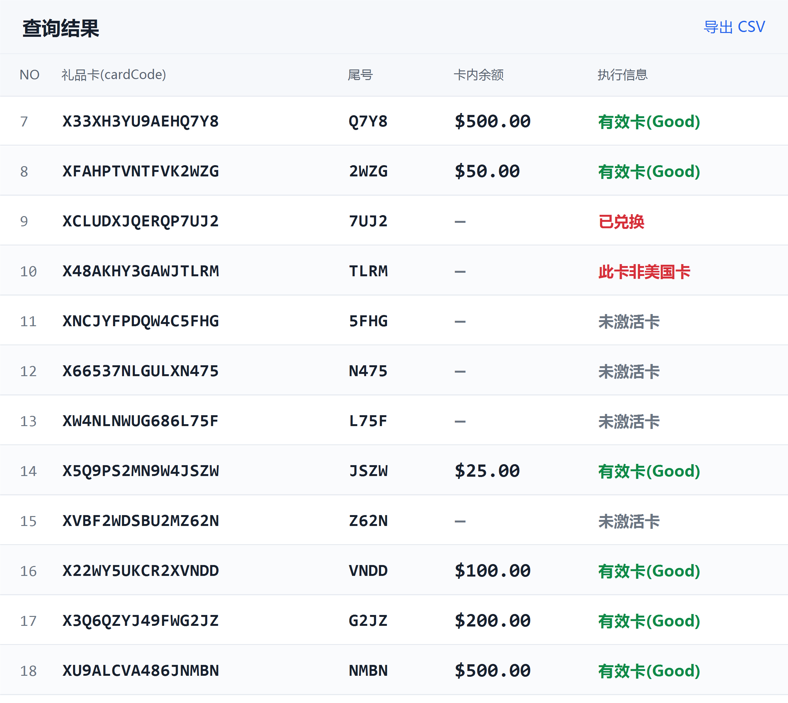

# Apple Gift Card and Balance Guides for GiftVeri

Start with Apple gift card balance checks, card identification, purchase-country questions and message triage. These practical guides connect common Apple card questions with GiftVeri's Windows documentation, followed by other gift card topics.

## Apple gift card guides

| Your question | Working guide |
| --- | --- |
| Am I inspecting an unused card or Apple Account credit? | [Apple gift card balance checklist](guides/apple-gift-card-balance-checklist.md) |
| Is this Apple Gift Card, App Store & iTunes or Apple Store Gift Card? | [Identify the Apple card product](guides/apple-gift-card-identification.md) |
| Which purchase country and regional entry apply? | [Apple gift card region preflight](guides/apple-gift-card-region-preflight.md) |
| What does an invalid, inactive, redeemed or unknown result establish? | [Apple gift card message triage](guides/apple-gift-card-message-triage.md) |

Keep the product, purchase country and operation separate. A card inquiry, a redemption action and an account-balance view need different evidence. Begin with one authorized card and preserve any uncertainty in the returned result.

## More gift card questions

| Your question | Read this guide |
| --- | --- |
| How do I check a gift card balance and confirm the result? | [Gift card balance check: a practical checklist](guides/gift-card-balance-checklist.md) |
| Which number, date, security code or PIN does a Visa or Vanilla checker need? | [Visa and Vanilla gift card balance: matching card fields](guides/visa-vanilla-card-fields.md) |
| Why is a gift card invalid, not activated, showing zero or declined? | [Gift card not working: activation, invalid codes and balance errors](guides/gift-card-error-triage.md) |

Begin with the issuer and the exact card product. A retailer gift card, a Visa prepaid gift card and account credit can require different instructions. Balance checks, redemption and purchase authorization answer different questions.

## Use GiftVeri on Windows

GiftVeri provides single-card workflows and, with the appropriate plan and client version, batch processing and result export. Check each brand and region's current scope before using it. A directory entry and a verified balance result are separate facts.

| What you need | Guide |
| --- | --- |
| Download, extract and open the client | [Install GiftVeri for Windows gift card balance checks](docs/getting-started.md) |
| Understand a balance, failure or unknown result | [Gift card balance results](docs/results.md) |
| Locate a launch, session, request or export problem | [Gift card checker troubleshooting](docs/troubleshooting.md) |
| Clarify plans, coverage and common questions | [Gift card balance checker FAQ](docs/faq.md) |

## The short workflow

1. Get the latest package from the [official Windows download page](https://www.giftveri.com/en/download).
2. Extract the whole RAR and keep `_internal` beside `Giftveri.exe`.
3. Confirm the card's brand, product type and region. Start with one card you are authorized to check.
4. Review the amount, currency, status and details together.
5. Keep uncertain tasks separate before starting more work or exporting results.

## Client interface

*Official interface example, shown in Chinese. The card codes, amounts and messages are demonstration data; this image is not evidence of a real-card result.*

## Version and coverage

The public download page was checked on November 8, 2026 and listed **v0.4.10**, Windows 64-bit, distributed as a RAR archive. Use the current download page for the package and its integrity details when installing or updating.

Feature availability depends on the installed version, selected workflow and plan. Refer to the [current product and plan information](https://www.giftveri.com/en) for the maintained overview. This documentation does not turn a development-build feature or a listed region into a verified stable-release result.

## Get help without sharing card secrets

Keep complete card numbers, PINs, passwords, verification codes and session tokens out of public reports. A useful report includes the client version, brand and region, time, the stage that failed and a redacted message.

Use the [official features and help page](https://www.giftveri.com/en/help) for product support information. Read [contribution guidance](CONTRIBUTING.md) before proposing a documentation change.

## About these guides

This repository contains public documentation and product illustrations. It does not contain the Windows application or its source code. Software licensing and distribution remain with the product publisher.

See the [documentation changelog](CHANGELOG.md) for changes to these guides.
